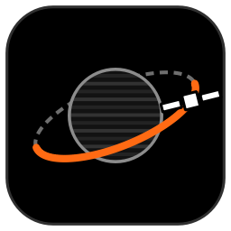
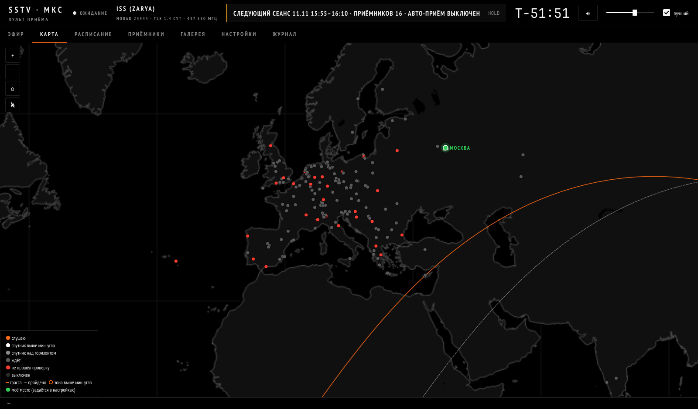
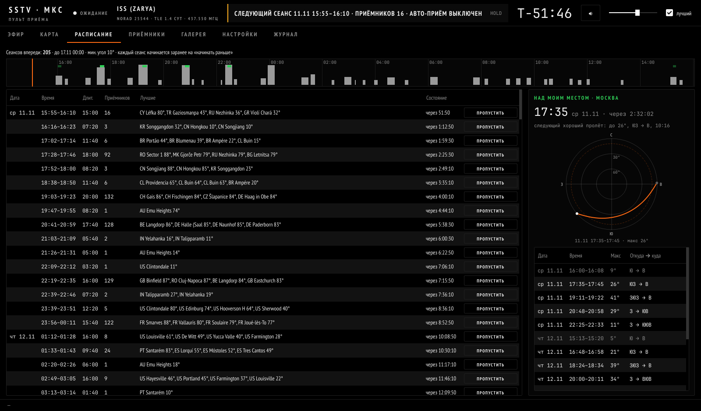
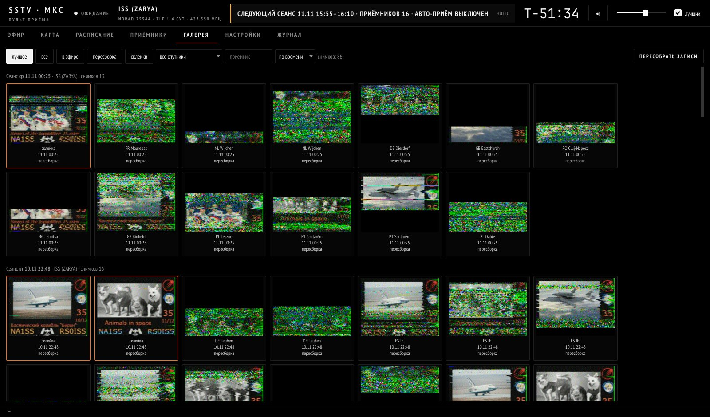

<p align="center"></p>

<p align="center"><a href="README.md">Русский</a> · <b>English</b></p>

# SSTV · ISS

A program that receives SSTV pictures from the ISS (and other satellites) **without an antenna of your own**.
It finds public online receivers (OpenWebRX, WebSDR) around the world, opens the ones
the station is passing over right now, corrects for Doppler, listens to the audio
and decodes Robot 36 pictures live. Pieces of the same picture from different
receivers are merged into one, line by line, using the best copy of each line.



**What it does**

- Finds receivers on rx-tx.info, ReceiverBook and websdr.org and checks
  that they can actually hear the required frequency.
- Calculates passes from a fresh orbit (TLE from CelesTrak) and builds a schedule
  of sessions: where and when the satellite will be above the receivers.
- During a pass, hands the signal over from receiver to receiver along the ground track,
  corrects for Doppler and, when needed, switches an OpenWebRX to the 70 cm band.
- Decodes Robot 36 robustly against noise and an inaccurate audio rate; shows
  the picture being received right now and a combined picture from all receivers.
- Shows an audio waterfall, the SSTV signal quality in percent and the level of
  every receiver; the audio of any receiver can be played right in the window.
- An offline vector world map: receivers, ground track, coverage zone,
  satellite following, your own location.
- Passes over your location, a polar pass diagram, receiver history
  (which ones really deliver pictures), a report after every session, an image gallery.
- Besides the ISS, a ready list of satellites that transmit SSTV: QMR-KWT-2 (“Kuwait Moon”),
  UmKA-1, VIZARD-meteo and others.
- Russian and English interface — the **RU / EN** switch in the top-right corner.
- The receiver's country is shown as a flag — on cards, on the map, in the schedule and gallery.

> Only the **Robot 36** mode is supported for now (the one the ISS uses in ARISS events
> and Roscosmos “SSTV from the ISS” events on 437.550 MHz FM).

---

## Contents

1. [Requirements](#requirements)
2. [Installation](#installation)
3. [First run](#first-run)
4. [Preparing for an SSTV event](#preparing-for-an-sstv-event)
5. [During a pass](#during-a-pass)
6. [After a pass: gallery, merges, reports](#after-a-pass-gallery-merges-reports)
7. [Another satellite or frequency](#another-satellite-or-frequency)
8. [Files and folders](#files-and-folders)
9. [Troubleshooting](#troubleshooting)
10. [How it works](#how-it-works)
11. [Building SSTV.exe](#building-sstvexe)
12. [Be kind to other people's receivers](#be-kind-to-other-peoples-receivers)
13. [Disclaimer](#disclaimer)
14. [Credits and licenses](#credits-and-licenses)
15. [Author and feedback](#author-and-feedback)
16. [License](#license)

---

## Requirements

- **Windows 10 or 11.** It also runs on Linux (`python3 qt_app.py` after installing the libraries from `requirements.txt` and `python3 -m playwright install chromium`); macOS has not been tested.
- The ready-made build needs nothing else. To run from source you need
  **Python 3.10–3.13** from [python.org](https://www.python.org/downloads/).
- Internet. Each receiver is an audio stream of roughly 30–100 kbit/s.
- Memory: about 100–150 MB per receiver listened to at the same time
  (8 receivers — about 1.5 GB).
- About 800 MB of disk space (the program together with the Chromium browser) plus space for recordings:
  audio is written as WAV, about 1.4 MB per minute per receiver.

## Installation

### Option 1: ready-made build (no Python needed)

1. Open the **[Releases](../../releases/latest)** page and download
   `SSTV-MKS-…-windows.zip` (a few hundred MB: everything is inside, including the browser).
2. Unpack it into an ordinary folder, for example `C:\SSTV-MKS` or the desktop.
   Not into `C:\Program Files`: the program keeps its settings and pictures next to itself,
   and Windows does not allow writing there.
3. Run **`SSTV.exe`**. You can make a shortcut (right click →
   “Send to” → “Desktop”).

On the first run Windows may show “Windows protected your PC” —
the program is not signed with a paid certificate. Click **“More info” → “Run anyway”**.
Antivirus software is sometimes suspicious of programs built with PyInstaller;
all the source code is open in this repository.

The program creates its own files next to `SSTV.exe`: `receivers.json`, `settings.json`,
the `sstv_out` folder with pictures, etc. To update, unpack the new
version over the old one (or copy these files into the new folder) — your settings and images are kept.

### Option 2: from source

**1. Install Python 3.10–3.13.** Download the installer from [python.org](https://www.python.org/downloads/),
run it and **be sure to tick “Add python.exe to PATH”** at the bottom of the first window.
To check: open a Command Prompt and type `python --version` — you should see
a version, for example `Python 3.12.7`.

**2. Download the program.** On the repository page click the green
**Code → Download ZIP** button and unpack it into a convenient folder, for example `C:\iss-sstv`.
Or, if you have git:

```
git clone https://github.com/smrplugg/iss-sstv-receiver.git
```

**3. Run `setup.bat`** (double click). It installs the libraries
(numpy, scipy, pillow, skyfield, Playwright, PyQt5) and the Chromium browser
the program uses to open online receivers, and creates an **“SSTV МКС”** shortcut
on the desktop and in the program folder. It takes a few minutes.
At the end it says “Готово” (“Done”).

## First run

Run `SSTV.exe` (ready-made build) or the **“SSTV МКС”** shortcut (from source; double-clicking `sstv.pyw` works too).
The program window opens — without a black console window.

The very first thing you see is the **rules for using other people's receivers and the
disclaimer** (the same as in [Be kind](#be-kind-to-other-peoples-receivers)
and [Disclaimer](#disclaimer)). The program starts only after you tick
“I have read and agree to follow these rules”. The consent is stored in
`rules_accepted.txt` next to the program; you can reread the rules in
“Settings → About”.

On start the program:

1. downloads a fresh ISS orbit (and then updates it by itself at most every 6 hours);
2. loads the receiver list (the repository already has a ready list of ~200);
3. calculates a schedule of sessions for a week ahead.

The top of the window shows the satellite and the orbit age, the program state and the
`T−` countdown to the next session (`T+` — how long the current one has been running).

The interface language is switched with the **RU / EN** buttons in the top-right corner.
The window is rebuilt immediately; reception in progress is not interrupted. On the first run
the language follows the Windows language. The log file on disk (`sstv_out\log.txt`) is always in Russian.

| Tab | What's there |
|---|---|
| **Live** | Receivers being listened to right now: picture, waterfall, elevation, Doppler, SSTV quality, sound. On the left — the combined pass picture. |
| **Map** | Receivers, the ground track and the satellite's coverage zone. Mouse wheel — zoom, drag — pan, 🛰 — follow the station. Click a receiver to see its passes and the sky above it. |
| **Schedule** | All sessions with the number of receivers and the best of them; on the right — passes over your location. Any session can be skipped. |
| **Receivers** | List, search, check, enable/disable, manual adding, history (“did it give a picture”). |
| **Gallery** | All images by session: time, receiver, satellite, quality. A report for every session. |
| **Settings** | Satellite, frequency, reception parameters, your location, map, “About”. |
| **Log** | A detailed log of what the program does. |

## Preparing for an SSTV event

Event dates are announced in advance (ARISS, AMSAT, Roscosmos “SSTV from the ISS”).
A day or two before the start:

**1. Update the receiver list.** Receivers tab → **“Find receivers”**.
A window with the rx-tx.info site opens (if an “I'm not a robot” check appears, complete it),
then the program queries every OpenWebRX found. Takes 5–10 minutes.
Existing receivers are kept.

**2. Check the receivers.** **“Check all”** — the program opens each one in turn
and makes sure audio on the right frequency is really coming. About 10 minutes.
Then **“Disable broken”** — receivers that failed the check stop being used in sessions
(you can enable them again with the green “ON” button).

**3. Set the end date.** “Settings” → “Run until” — the date and time the event ends.
By default — a week from the start.

**4. (Optional) Set your location.** “Settings” → “My location”: type the coordinates
or click on the map. Passes over you will appear in the Schedule tab,
and a green dot on the map.

**5. Turn on auto receive.** The “auto receive” checkbox in the Live tab (or in Settings).
From then on the program starts every session a minute before the pass and stops
after it. The computer must stay on and must not go to sleep.

**Check the sound right now:** the **“Test 60 s”** button in the Live tab opens
the receivers with the satellite highest above them for one minute.

## During a pass

- Each receiver card shows the picture being received, the audio **waterfall**
  (SSTV sync pulses are a line at 1200 Hz, the picture is 1500…2300 Hz),
  **SSTV %** — how confidently sync pulses are seen over the last 3 s,
  the audio level, elevation, azimuth and Doppler.
- **Sound:** master volume in the header; every receiver has its own volume and speaker button.
  **All receivers start with the speaker off** — recording and decoding happen
  regardless, and sound reaches your speakers only if:
  - the **“best”** checkbox in the header is ticked (on by default) — then the receiver
    with the strongest SSTV is played, or
  - the speaker is turned on on a receiver card.

  If neither is on, there will be no sound at all.
- The **combined picture** on the left is assembled every 3 s from all receivers:
  each line is taken from wherever it was received best.
- **“Stop”** stops the session; what was recorded is saved and merged.



## After a pass: gallery, merges, reports

- Pictures are saved immediately during reception. At the end of a session, pieces of the same picture
  from different receivers are merged into `combined_NN.png` — only if they could
  be reliably aligned by common lines. Each line of the merge is the average over all
  receivers where it was received not much worse than the best one (weighted by quality), so
  there is less noise than from any single receiver.
- **Gallery** → the “best” filter shows merges and the best versions. Click to
  enlarge, ← → arrows to browse, “Open folder” and “Save as…” are there too.
- The **“report”** button of a session: what each receiver delivered (elevation, how long it was listened to,
  SSTV %, how many pictures).
- **“Re-decode recordings”** runs all saved WAV files through the decoder again —
  useful after updating the program: sometimes pictures missed on air are found.
- The program remembers which receivers delivered pictures and prefers them
  when choosing receivers for a session (can be turned off in Settings).



## Another satellite or frequency

“Settings” → “Satellite”:

- **Preset** — a list of satellites that transmit SSTV in Robot 36; choosing one
  sets the NORAD ID and the frequency:

  | Satellite | Frequency, MHz |
  |---|---|
  | ISS | 437.550 (in ARISS events on 70 cm) |
  | QMR-KWT-2 “Kuwait Moon” (RS95S) | 436.950 |
  | UmKA-1 (RS40S) | 437.625 |
  | VIZARD-meteo (RS38S) | 437.825 |
  | UTMN-2 (RS27S) | 436.125 |
  | Monitor-3 (RS58S) | 435.290 |
  | Monitor-4 (RS57S) | 436.080 |
  | SakhaCube-Cholbon (RS18S) | 437.350 |
  | GALAPAGOS-UTE-SWSU (HC1PX) | 437.050 |

  Apart from the ISS, all of them transmit pictures only occasionally — schedules are published
  on the Libre Space Community and AMSAT-BB. Source of the list: the AMSAT “Image Satellites” page.
- **NORAD ID** — the satellite's catalog number (ISS — 25544); the orbit is downloaded automatically;
- **Manual TLE** — if you need to enter the orbit yourself (three lines: a name and two TLE lines).
- The **“Apply satellite”** button saves only the satellite and the frequency — no need to look for
  the Save button at the bottom. The line below it shows what is going on:
  “Downloading TLE…”, “Calculating the schedule…”, and finally “Done” with the number of sessions —
  or the reason if the orbit could not be obtained. If reception is in progress, the satellite changes
  after the session.

“Signal” → **frequency** in MHz. Note: the receiver list was checked on 437.550 MHz;
on another frequency only OpenWebRX receivers that have a profile for it will work —
after changing the frequency it is worth running “Find receivers” and “Check all” again.

## Files and folders

All paths are relative to the program folder (where `SSTV.exe` or the source code is).

| What | Where |
|---|---|
| Session pictures and audio | `sstv_out\<date_time>\<receiver>\` |
| Merges | `sstv_out\<date_time>\combined_NN.png` |
| Re-decoded pictures | `sstv_out\<date_time>\redecoded\` |
| Session report | `sstv_out\<date_time>\report.txt` (and `.json`) |
| Log | `sstv_out\log.txt` (the same as the Log tab, in Russian) |
| Program errors | `sstv_out\console.log` |
| Receiver list | `receivers.json` (updated by the search) |
| Added manually | `receivers_user.json` |
| Check results | `check.json` |
| Settings | `settings.json`, window state and language — `ui_state.json` |
| Orbit cache | `tle_cache.json` |

## Troubleshooting

**`python` not found / setup.bat closes immediately.** Python was installed without
“Add python.exe to PATH”. Reinstall Python with that option ticked.

**“TLE not downloaded … 403”.** CelesTrak temporarily limits too frequent requests.
The program takes the orbit from backup sources or from the cache; after
a few hours CelesTrak answers again.

**Receivers are open but there is no sound.** Check the **“best”** checkbox in the header
or turn on the speaker on the card of the receiver you want — by default it is off.

**“sound unavailable” in the header.** No audio output device was found. Check that
a playback device is selected in Windows. Reception and decoding work without sound too.

**A receiver “did not open” or has “no sound”.** Amateur receivers often
go offline or change settings. The program takes the next one instead.
Broken ones are weeded out with “Check all” → “Disable broken”.

**No pictures even though the signal is audible.** The decoder may not be able to pull out a very weak
signal. Try “Re-decode recordings” after the session. Merging
with other receivers often helps.

**The window does not open.** Look into `sstv_out\console.log` next to the program: errors are written there.
If you run from source and libraries are missing, the program shows a message — run `setup.bat`.
You can also start it from a command prompt to see everything at once: `python qt_app.py`
in the program folder.

**No desktop shortcut** (source version). Run `python make_shortcut.py` in the program folder.

**The computer is slow, the sound stutters.** Lower “Receivers at once” in Settings.

## How it works

- `sstv.pyw` — start without a console; `make_shortcut.py` — a shortcut with an icon.
- `paths.py` — where the program files and data are (next to `SSTV.exe` in the ready-made build).
- `qt_app.py` — the window (PyQt5): tabs, map, sound.
- `engine.py` — the core behind the window: schedule, sessions, history, reports, gallery.
- `iss_sstv.py` — reception: orbit, choosing receivers, controlling
  OpenWebRX/WebSDR pages through Playwright, Doppler, audio recording.
- `robot36.py` — the Robot 36 decoder: instantaneous frequency via the Hilbert
  transform, sync pulse search with adjustment to the real audio rate,
  noise suppression, decoding on the fly.
- `combine.py` — merging pieces from different receivers by line correlation (weighted average).
- `redecode.py` — reprocessing saved recordings.
- `scan.py` — receiver search (rx-tx.info, ReceiverBook, websdr.org).
- `tle.py` — orbits with a cache and backup sources.
- `about.py` — version, author, repository link.
- `i18n.py` — the English translation of the interface and language switching.
- `ui/flags/` — country flags for receivers.
- `tools/make_icon.py` — draws the `ui/icon.*` icon.

Audio from a receiver is captured inside the page (Web Audio), passed
to Python, resampled to 12 kHz and written to WAV; in parallel it is processed by
the live decoder.

## Building SSTV.exe

The ready-made archive is built automatically on GitHub servers
([.github/workflows/release.yml](.github/workflows/release.yml)): just
publish a version tag, for example `v1.1.0` (via “Releases → Draft a new release →
Choose a tag” or `git tag v1.1.0 && git push --tags`). About 10 minutes later
`SSTV-MKS-v1.1.0-windows.zip` appears in that release. The build can also be started
manually: **Actions → “Сборка Windows” → Run workflow**.

To build locally: install everything as in option 2 and run `build.bat` —
the ready program appears in `dist\SSTV-MKS`. The build is done by
[PyInstaller](https://pyinstaller.org) from `sstv.spec`; the Chromium browser
is put inside the build (`PLAYWRIGHT_BROWSERS_PATH=0`).

Before a new release, change the version in `about.py`.

## Be kind to other people's receivers

Online receivers are run by radio amateurs — free, for everyone.
An OpenWebRX has **one tuner shared by all listeners**: if the program switches
a receiver to 70 cm, everyone else listening to it ends up on 70 cm too.
The program tries to be careful: it switches only for the duration of a pass,
backs off if someone switches the band back, and logs how many listeners there were.
If you don't want to touch other people's settings at all, turn on
“do not switch the band on OpenWebRX” in Settings: then
only receivers that are already on 70 cm are used.

Don't use a very large number of receivers at once without need — many
owners have limited bandwidth. And don't forget to thank receiver owners
if you got a good picture.

**Rules worth keeping:**

- **8–12 receivers at once** (8 by default) are enough to follow a pass
  from horizon to horizon. More gives almost nothing but disturbs many people at once,
  so **the program never opens more than 12** — not in a session, not in a test, not in a check.
- Connect only **for the duration of a pass**. The program does exactly that; don't keep
  receivers open “just in case”.
- If a receiver's owner asks not to switch the band, limits session time
  or the number of listeners — **disable that receiver** in the program
  (the “OFF” button in the Receivers tab).
- Run the check of all receivers (“Check all”) and the search before an event,
  not every half hour: that is also load on other people's servers.
- If someone is listening to another band on a receiver right now and you don't want
  to kick them off — turn on “do not switch the band on OpenWebRX”.

## Disclaimer

The program is provided **“as is”**, without any warranty: the author does not
promise that it will work without errors, receive pictures or be fit
for any particular purpose.

The program only **automates what a person does by hand** in a browser:
it opens publicly available web pages of online receivers, selects a frequency and listens
to the audio. None of the receivers belongs to or is affiliated with the author.

**Users are responsible for how they use it**, including:

- the number of receivers connected at once and the load on other people's servers
  and links;
- switching the band on receivers used by other people;
- following the rules of individual receivers and directory sites
  (rx-tx.info, ReceiverBook, websdr.org), their owners' terms and the laws of their country;
- the recordings and pictures received and saved.

The author is not liable for any damage, inconvenience, bans,
claims of receiver owners or third parties arising from the
use of the program. If a receiver's owner objects to automated
connections, respect their decision and disable their receiver in the program.

## Credits and licenses

- Receiver lists: [rx-tx.info](https://rx-tx.info), [ReceiverBook](https://www.receiverbook.de),
  [websdr.org](http://websdr.org).
- Orbits: [CelesTrak](https://celestrak.org), backups — [tle.ivanstanojevic.me](https://tle.ivanstanojevic.me), AMSAT.
- Orbit calculation: [Skyfield](https://rhodesmill.org/skyfield/).
- Map: [Natural Earth](https://www.naturalearthdata.com) (public domain).
- Fonts: PT Sans Narrow (ParaType) and JetBrains Mono — SIL Open Font
  License 1.1, license texts are in `ui/fonts/`.
- Flags: [flag-icons](https://github.com/lipis/flag-icons) — MIT license, text in `ui/flags/`.
- List of SSTV satellites: AMSAT, the “Image Satellites” page.
- SSTV events from the ISS are run by [ARISS](https://www.ariss.org) and Roscosmos.

## Author and feedback

Author: [smrplugg](https://github.com/smrplugg).

Bugs, questions and suggestions — in [Issues](https://github.com/smrplugg/iss-sstv-receiver/issues).
If the program caught a picture for you, you're welcome to show it off there too.

## License

The code is distributed under the [MIT](LICENSE) license. Fonts — SIL OFL 1.1 (see `ui/fonts/`),
flags — MIT (flag-icons), map — public domain (Natural Earth).
