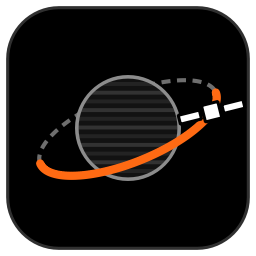
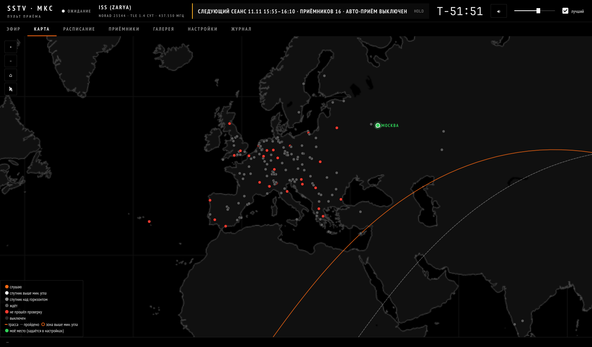
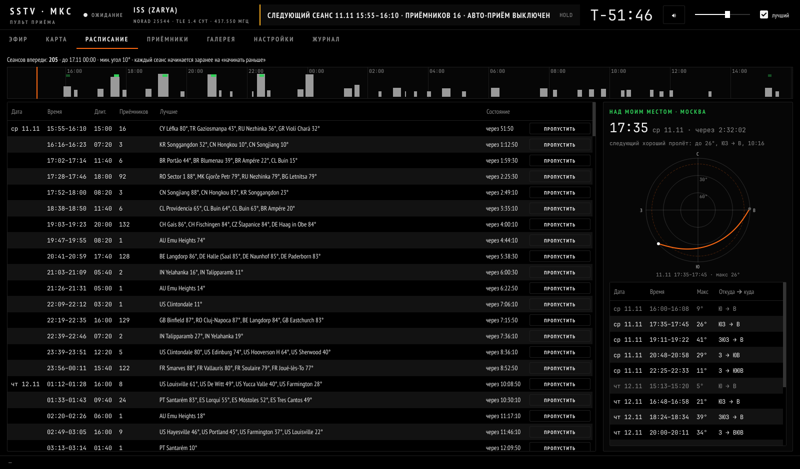
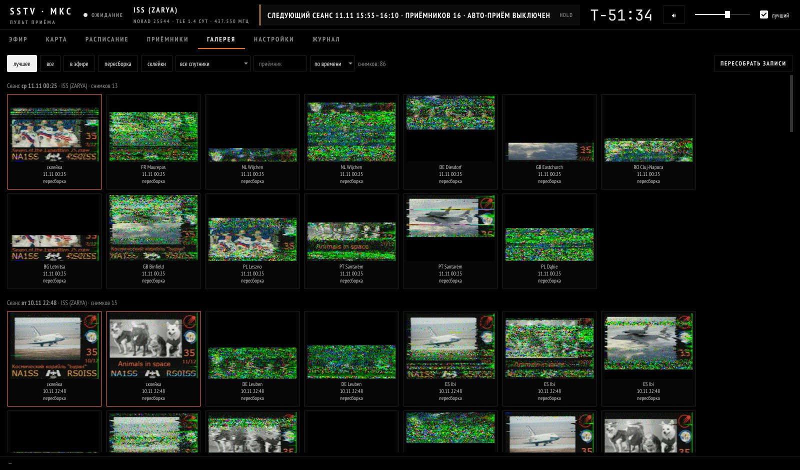

<p align="center"></p>

# SSTV · МКС — пульт приёма

Программа для приёма SSTV-картинок с МКС (и других спутников) **без своей антенны**:
она сама находит публичные онлайн-приёмники (OpenWebRX, WebSDR) по всему миру,
открывает те, над которыми сейчас пролетает станция, ведёт доплер, слушает звук
и прямо в эфире декодирует картинки Robot 36. Куски одной картинки с разных
приёмников склеиваются в одну — по лучшим строкам.



**Что умеет**

- Находит приёмники на rx-tx.info, ReceiverBook и websdr.org и проверяет,
  что они действительно слышат нужную частоту.
- Считает пролёты по свежей орбите (TLE с CelesTrak) и строит расписание
  сеансов: где и когда спутник будет над приёмниками.
- Во время пролёта передаёт «эстафету» от приёмника к приёмнику вдоль трассы,
  ведёт доплер, при необходимости переключает диапазон OpenWebRX на 70 см.
- Декодирует Robot 36 устойчиво к шуму и неточной скорости звука; показывает
  картинку, которая принимается прямо сейчас, и сводную картинку со всех приёмников;
  складывает повторы одной картинки из разных пролётов в одну, более чистую.
- Показывает водопад звука, качество сигнала SSTV в процентах и уровень по
  каждому приёмнику; звук любого приёмника можно слушать прямо в окне.
- Векторная карта мира без интернета: приёмники, трасса, зона видимости,
  слежение за станцией, своё место.
- Пролёты над твоим местом, полярная диаграмма пролёта, история приёмников
  (кто реально даёт картинки), отчёт после каждого сеанса, галерея снимков.

> Сейчас поддерживается режим **Robot 36** (его использует МКС в акциях ARISS
> и «SSTV с МКС» на 437.550 МГц FM).

---

## Содержание

1. [Что нужно](#что-нужно)
2. [Установка](#установка)
3. [Первый запуск](#первый-запуск)
4. [Подготовка к акции SSTV](#подготовка-к-акции-sstv)
5. [Во время пролёта](#во-время-пролёта)
6. [После пролёта: галерея, склейки, отчёты](#после-пролёта-галерея-склейки-отчёты)
7. [Другой спутник или частота](#другой-спутник-или-частота)
8. [Файлы и папки](#файлы-и-папки)
9. [Если что-то не так](#если-что-то-не-так)
10. [Как это устроено](#как-это-устроено)
11. [Сборка SSTV.exe](#сборка-sstvexe)
12. [Вежливость к чужим приёмникам](#вежливость-к-чужим-приёмникам)
13. [Отказ от ответственности](#отказ-от-ответственности)
14. [Благодарности и лицензии](#благодарности-и-лицензии)
15. [Автор и обратная связь](#автор-и-обратная-связь)
16. [Лицензия](#лицензия)

---

## Что нужно

- **Windows 10 или 11.** На Linux тоже запускается (`python3 qt_app.py` после установки библиотек из `requirements.txt` и `python3 -m playwright install chromium`); macOS не проверялась.
- Для готовой программы больше ничего не нужно. Для запуска из исходников —
  **Python 3.10–3.13** с сайта [python.org](https://www.python.org/downloads/).
- Интернет. Каждый приёмник — это поток звука примерно 30–100 кбит/с.
- Память: примерно 100–150 МБ на каждый одновременно слушаемый приёмник
  (8 приёмников — около 1,5 ГБ).
- Около 800 МБ на диске (программа вместе с браузером Chromium) плюс место под записи:
  звук пишется в WAV, примерно 1,4 МБ в минуту на приёмник.

## Установка

### Вариант 1: готовая программа (Python не нужен)

1. Открой страницу **[Releases](../../releases/latest)** и скачай архив
   `SSTV-MKS-…-windows.zip` (несколько сотен МБ: внутри уже есть всё, включая браузер).
2. Распакуй его в обычную папку, например `C:\SSTV-MKS` или на рабочий стол.
   Не в `C:\Program Files`: программа хранит настройки и картинки рядом с собой,
   а туда Windows писать не даёт.
3. Запусти **`SSTV.exe`**. Для удобства можно сделать ярлык (правой кнопкой →
   «Отправить» → «Рабочий стол»).

При первом запуске Windows может показать «Windows защитил ваш компьютер» —
программа не подписана платным сертификатом. Нажми **«Подробнее» → «Выполнить в
любом случае»**. Антивирус тоже иногда настороженно относится к программам,
собранным PyInstaller; исходный код весь открыт в этом репозитории.

Рядом с `SSTV.exe` программа создаст свои файлы: `receivers.json`, `settings.json`,
папку `sstv_out` с картинками и т. д. Чтобы обновить программу, распакуй новую
версию поверх старой (или скопируй эти файлы в новую папку) — настройки и снимки сохранятся.

### Вариант 2: из исходного кода

**1. Поставь Python 3.10–3.13.** Скачай установщик с [python.org](https://www.python.org/downloads/),
запусти и **обязательно отметь галочку «Add python.exe to PATH»** внизу первого окна.
Проверить: открой «Командную строку» и набери `python --version` — должна
появиться версия, например `Python 3.12.7`.

**2. Скачай программу.** На странице репозитория нажми зелёную кнопку
**Code → Download ZIP** и распакуй архив в удобную папку, например `C:\iss-sstv`.
Или, если есть git:

```
git clone https://github.com/smrplugg/iss-sstv-receiver.git
```

**3. Запусти `setup.bat`** (двойной щелчок). Он поставит библиотеки
(numpy, scipy, pillow, skyfield, Playwright, PyQt5), браузер Chromium, через
который программа открывает онлайн-приёмники, и создаст ярлык **«SSTV МКС»**
на рабочем столе и в папке программы. Это займёт несколько минут.
В конце будет надпись «Готово».

## Первый запуск

Запусти `SSTV.exe` (готовая программа) или ярлык **«SSTV МКС»** (из исходников; можно и двойной щелчок по `sstv.pyw`).
Откроется окно программы — без чёрного окна консоли.

Самым первым появится окно **правил работы с чужими приёмниками и отказа от
ответственности** (то же, что в разделах [Вежливость](#вежливость-к-чужим-приёмникам)
и [Отказ от ответственности](#отказ-от-ответственности)). Программа запустится только
после галочки «Прочитал, согласен и буду соблюдать». Согласие сохраняется в
`rules_accepted.txt` рядом с программой; перечитать правила можно в
«Настройки → О программе».

При старте программа:

1. скачает свежую орбиту МКС (дальше обновляет её сама не чаще раза в 6 часов);
2. загрузит список приёмников (в репозитории уже есть готовый список ~200 штук);
3. посчитает расписание сеансов на неделю вперёд.

Вверху окна видно: спутник и возраст орбиты, состояние программы и обратный
отсчёт `T−` до следующего сеанса (`T+` — сколько идёт текущий).

| Вкладка | Что там |
|---|---|
| **Эфир** | Приёмники, которые слушаются сейчас: картинка, водопад, угол, доплер, качество SSTV, звук. Слева — сводная картинка пролёта. |
| **Карта** | Приёмники, трасса и зона видимости спутника. Колесо мыши — зум, перетаскивание — сдвиг, 🛰 — следить за станцией. Щелчок по приёмнику — его пролёты и небо над ним. |
| **Расписание** | Все сеансы с числом приёмников и лучшими из них; справа — пролёты над твоим местом. Любой сеанс можно пропустить. |
| **Приёмники** | Список, поиск, проверка, вкл/выкл, ручное добавление, история («давал ли картинку»). |
| **Галерея** | Все снимки по сеансам: время, приёмник, спутник, качество. Отчёт по каждому сеансу. |
| **Настройки** | Спутник, частота, параметры приёма, своё место, карта, «О программе». |
| **Журнал** | Подробный лог работы. |

## Подготовка к акции SSTV

Даты акций публикуются заранее (ARISS, AMSAT, «SSTV с МКС» Роскосмоса).
За день-два до начала:

**1. Обнови список приёмников.** Вкладка «Приёмники» → **«Искать приёмники»**.
Откроется окно сайта rx-tx.info (если появится проверка «я не робот» — пройди её),
затем программа опросит все найденные OpenWebRX. Займёт 5–10 минут.
Прежние приёмники не теряются.

**2. Проверь приёмники.** **«Проверить все»** — программа по очереди откроет каждый
и убедится, что звук на нужной частоте реально идёт. Около 10 минут.
Затем **«Выключить неработающие»** — не прошедшие проверку перестанут попадать в сеансы
(включить обратно можно зелёной кнопкой «ВКЛ»).

**3. Укажи срок.** «Настройки» → «Работать до» — дата и время окончания акции.
По умолчанию — неделя от запуска.

**4. (Необязательно) Укажи своё место.** «Настройки» → «Моё место»: координаты
вписать или щёлкнуть по карте. Во вкладке «Расписание» появятся пролёты над тобой,
на карте — зелёная точка.

**5. Включи авто-приём.** Галочка «авто-приём» во вкладке «Эфир» (или в настройках).
Дальше программа сама начинает каждый сеанс за минуту до пролёта и заканчивает
после. Компьютер должен быть включён и не уходить в сон.

**Проверка звука прямо сейчас:** кнопка **«Тест 60 с»** во вкладке «Эфир» открывает
приёмники, над которыми спутник выше всего, на минуту.

## Во время пролёта

- На каждой карточке приёмника: принимаемая картинка, **водопад** звука
  (синхроимпульсы SSTV — линия на 1200 Гц, картинка — 1500…2300 Гц),
  **SSTV %** — насколько уверенно видны синхроимпульсы за последние 3 с,
  уровень звука, угол, азимут, доплер.
- **Звук:** общая громкость в шапке; у каждого приёмника своя громкость и кнопка-динамик.
  **У всех приёмников динамик изначально выключен** — запись и декодирование идут
  в любом случае, а в колонки звук попадает, только если:
  - стоит галочка **«лучший»** в шапке (включена по умолчанию) — тогда играет приёмник
    с самым сильным SSTV, или
  - на карточке приёмника включён его динамик.

  Если ни то, ни другое не включено, звука не будет вовсе.
- **Сводная картинка** слева собирается каждые 3 с из всех приёмников:
  каждая строка берётся оттуда, где она принята лучше.
- **«Стоп»** останавливает сеанс; записанное сохраняется и склеивается.



## После пролёта: галерея, склейки, отчёты

- Картинки сохраняются сразу во время приёма. В конце сеанса куски одной картинки
  с разных приёмников склеиваются в `combined_NN.png` — только если их удалось
  надёжно совместить по общим строкам. Каждая строка склейки — среднее по всем
  приёмникам, где она принята не сильно хуже лучшего (с весом по качеству), поэтому
  шума меньше, чем у любого отдельного приёмника.
- **Стопки.** МКС за акцию много раз передаёт один и тот же набор картинок по кругу.
  После каждого сеанса программа находит одинаковые картинки из разных пролётов и
  складывает их: из 10–20 приёмов получается заметно более чистая картинка.
  Результат — `sstv_out\stack\stack_NN.png`, в галерее фильтр **«стопки»**.
  Картинки, принятые старыми версиями, попадут в стопки после «Пересобрать записи».
- **Галерея** → фильтр «лучшее» показывает склейки и лучшие варианты. Щелчок —
  крупно, стрелки ← → листают, есть «Открыть папку» и «Сохранить как…».
- Кнопка **«отчёт»** у сеанса: какой приёмник что дал (угол, сколько слушал,
  SSTV %, сколько картинок).
- **«Пересобрать записи»** прогоняет все сохранённые WAV заново через декодер и
  заново складывает стопки — полезно после обновления программы: иногда находятся
  картинки, пропущенные в эфире.
- Программа запоминает, какие приёмники давали картинки, и при выборе в сеанс
  отдаёт им предпочтение (отключается в настройках).



## Другой спутник или частота

«Настройки» → «Спутник»:

- **NORAD ID** — номер спутника в каталоге (МКС — 25544); орбита скачается сама;
- **TLE вручную** — если орбиту нужно вписать самому (три строки: имя и две строки TLE).

«Сигнал» → **частота** в МГц. Учти: список приёмников проверялся на 437.550 МГц;
на другой частоте подойдут только те OpenWebRX, у которых есть профиль на неё —
после смены частоты стоит снова сделать «Искать приёмники» и «Проверить все».

## Файлы и папки

Все пути — от папки программы (там, где `SSTV.exe` или исходники).

| Что | Где |
|---|---|
| Картинки и звук сеансов | `sstv_out\<дата_время>\<приёмник>\` |
| Склейки | `sstv_out\<дата_время>\combined_NN.png` |
| Пересобранные картинки | `sstv_out\<дата_время>\redecoded\` |
| Стопки повторов | `sstv_out\stack\stack_NN.png` (и `.json` — из каких приёмов) |
| Отчёт сеанса | `sstv_out\<дата_время>\report.txt` (и `.json`) |
| Журнал | `sstv_out\log.txt` (то же, что во вкладке «Журнал») |
| Ошибки программы | `sstv_out\console.log` |
| Список приёмников | `receivers.json` (обновляется поиском) |
| Добавленные вручную | `receivers_user.json` |
| Результаты проверки | `check.json` |
| Настройки | `settings.json`, состояние окна — `ui_state.json` |
| Кэш орбит | `tle_cache.json` |

## Если что-то не так

**`python` не найден / setup.bat сразу закрывается.** Python поставлен без
галочки «Add python.exe to PATH». Переустанови Python с этой галочкой.

**«TLE не скачан … 403».** CelesTrak временно ограничивает слишком частые запросы.
Программа сама возьмёт орбиту из запасных источников или из кэша; через
несколько часов CelesTrak снова начнёт отвечать.

**Приёмники открыты, а звука не слышно.** Проверь галочку **«лучший»** в шапке
или включи динамик на карточке нужного приёмника — по умолчанию у приёмников он выключен.

**«звук недоступен» в шапке.** Не найдено устройство вывода звука. Проверь, что
в Windows выбрано устройство воспроизведения. Приём и декодирование работают и без звука.

**Приёмник «не открылся» или «нет звука».** Любительские приёмники часто
выключаются или меняют настройки. Программа сама берёт вместо него следующий.
Нерабочие отсеиваются через «Проверить все» → «Выключить неработающие».

**Картинок нет, хотя сигнал слышно.** Очень слабый сигнал декодер может не
вытянуть. Попробуй после сеанса «Пересобрать записи». Часто спасает склейка
с других приёмников.

**Окно не открывается.** Загляни в `sstv_out\console.log` рядом с программой: туда пишутся ошибки.
Если запускаешь из исходников и не хватает библиотек, программа покажет сообщение — запусти `setup.bat`.
Можно запустить и из командной строки, чтобы видеть всё сразу: `python qt_app.py`
в папке программы.

**Нет ярлыка на рабочем столе** (вариант из исходников). Запусти в папке программы `python make_shortcut.py`.

**Компьютер тормозит, звук с разрывами.** Уменьши «Приёмников одновременно» в настройках.

## Как это устроено

- `sstv.pyw` — запуск без консоли; `make_shortcut.py` — ярлык с иконкой.
- `paths.py` — где лежат файлы программы и данные (рядом с `SSTV.exe` в готовой версии).
- `qt_app.py` — окно (PyQt5): вкладки, карта, звук.
- `engine.py` — ядро для окна: расписание, сеансы, история, отчёты, галерея.
- `iss_sstv.py` — приём: орбита, выбор приёмников, управление страницами
  OpenWebRX/WebSDR через Playwright, доплер, запись звука.
- `robot36.py` — декодер Robot 36: мгновенная частота через преобразование
  Гильберта, поиск синхроимпульсов с подстройкой под реальную скорость звука,
  подавление шума, декодирование «на лету».
- `combine.py` — склейка кусков с разных приёмников по корреляции строк (средневзвешенно).
- `stack.py` — стопки: одна картинка из многих пролётов.
- `redecode.py` — повторная обработка сохранённых записей.
- `scan.py` — поиск приёмников (rx-tx.info, ReceiverBook, websdr.org).
- `tle.py` — орбиты с кэшем и запасными источниками.
- `about.py` — версия, автор, ссылка на репозиторий.
- `tools/make_icon.py` — рисует иконку `ui/icon.*`.

Звук с приёмника перехватывается внутри страницы (Web Audio), передаётся
в Python, пересчитывается в 12 кГц и пишется в WAV; параллельно его разбирает
живой декодер.

## Сборка SSTV.exe

Готовый архив собирается автоматически на серверах GitHub
([.github/workflows/release.yml](.github/workflows/release.yml)): достаточно
опубликовать тег версии, например `v1.0.0` (через «Releases → Draft a new release →
Choose a tag» или `git tag v1.0.0 && git push --tags`). Примерно через 10 минут
архив `SSTV-MKS-v1.0.0-windows.zip` появится в этом релизе. Сборку можно запустить
и вручную: вкладка **Actions → «Сборка Windows» → Run workflow**.

Собрать у себя: установи всё по варианту 2 и запусти `build.bat` —
готовая программа появится в `dist\SSTV-MKS`. Сборка делается
[PyInstaller](https://pyinstaller.org) по файлу `sstv.spec`; браузер Chromium
кладётся внутрь сборки (`PLAYWRIGHT_BROWSERS_PATH=0`).

Перед новым релизом поменяй версию в `about.py`.

## Вежливость к чужим приёмникам

Онлайн-приёмники держат радиолюбители — бесплатно и для всех.
У OpenWebRX **один тюнер на всех слушателей**: если программа переключает
приёмник на 70 см, другие слушатели этого приёмника тоже окажутся на 70 см.
Программа старается быть аккуратной: переключает только на время пролёта,
уступает, если кто-то вернул диапазон, и пишет в лог, сколько было слушателей.
Если не хочешь трогать чужие настройки вообще — включи в настройках
«не переключать диапазон на OpenWebRX»: тогда
используются только приёмники, которые и так стоят на 70 см.

Не ставь без нужды очень большое число одновременных приёмников — у многих
владельцев ограничен канал. И не забывай благодарить владельцев приёмников,
если получилась хорошая картинка.

**Правила, которых стоит держаться:**

- **8–12 приёмников одновременно** (по умолчанию 8) хватает, чтобы вести пролёт
  от края до края. Больше почти ничего не даёт, а мешает уже многим людям сразу.
- Подключайся только **на время пролёта**. Программа сама так и делает; не держи
  приёмники открытыми «на всякий случай».
- Если владелец приёмника просит не переключать диапазон, ограничивает время
  сеанса или число слушателей — **выключи этот приёмник** в программе
  (кнопка «ВЫКЛ» во вкладке «Приёмники»).
- Проверку всех приёмников («Проверить все») и поиск запускай перед акцией,
  а не каждые полчаса: это тоже нагрузка на чужие серверы.
- Если на приёмнике сейчас кто-то слушает другой диапазон, а ты не хочешь
  его выбивать — включи «не переключать диапазон на OpenWebRX».

## Отказ от ответственности

Программа распространяется **«как есть»**, без каких-либо гарантий: автор не
обещает, что она будет работать без ошибок, принимать картинки или подходить
для какой-то цели.

Программа только **автоматизирует то же, что человек делает руками** в браузере:
открывает общедоступные веб-страницы онлайн-приёмников, выбирает частоту и слушает
звук. Ни один приёмник не принадлежит автору программы и не связан с ним.

**Пользователь сам отвечает за то, как он её использует**, в том числе:

- за число одновременно подключённых приёмников и нагрузку на чужие серверы
  и каналы связи;
- за переключение диапазона на приёмниках, которыми пользуются другие люди;
- за соблюдение правил конкретных приёмников и сайтов-каталогов
  (rx-tx.info, ReceiverBook, websdr.org), условий их владельцев и законов своей страны;
- за принятые и сохранённые записи и картинки.

Автор программы не несёт ответственности за любой ущерб, неудобства, блокировки,
претензии владельцев приёмников или третьих лиц, возникшие в результате
использования программы. Если владелец приёмника против автоматических
подключений — уважай его решение и выключи его приёмник в программе.

## Благодарности и лицензии

- Списки приёмников: [rx-tx.info](https://rx-tx.info), [ReceiverBook](https://www.receiverbook.de),
  [websdr.org](http://websdr.org).
- Орбиты: [CelesTrak](https://celestrak.org), запасные — [tle.ivanstanojevic.me](https://tle.ivanstanojevic.me), AMSAT.
- Расчёт орбит: [Skyfield](https://rhodesmill.org/skyfield/).
- Карта: [Natural Earth](https://www.naturalearthdata.com) (общественное достояние).
- Шрифты: PT Sans Narrow (ParaType) и JetBrains Mono — лицензия SIL Open Font
  License 1.1, тексты лицензий лежат в `ui/fonts/`.
- Акции SSTV с МКС проводят [ARISS](https://www.ariss.org) и Роскосмос.

## Автор и обратная связь

Автор: [smrplugg](https://github.com/smrplugg).

Ошибки, вопросы и пожелания — в [Issues](https://github.com/smrplugg/iss-sstv-receiver/issues).
Если программа поймала у тебя картинку — тоже можно похвастаться там.

## Лицензия

Код распространяется по лицензии [MIT](LICENSE). Шрифты — SIL OFL 1.1 (см. `ui/fonts/`),
карта — общественное достояние (Natural Earth).
